

<a name="arcade"></a>

 
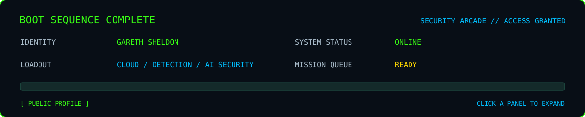

**ARCADE MENU // PLAYER 001**

- **Start run:** explore my security engineering background and current work.
- **Choose class:** cloud security, detection engineering, offensive security or AI/MCP security.
- **Mission select:** open the projects and security tools I build.
- **Boss stage:** see the threat areas and security controls I work with.
- **Connect:** portfolio, LinkedIn, Credly and Hack The Box.

  <b>Gareth Sheldon</b> is an Information Security Engineer working across cloud security, identity governance, detection engineering, incident response and AI agent security. 
  I build and validate security controls, investigate threats and turn technical findings into repeatable engineering improvements.

The arcade is live. The threats are real. Every control needs to earn its place.

<a name="quest">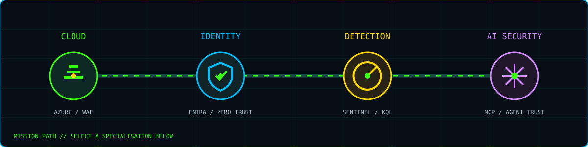</a>

 
**SELECT YOUR ROUTE**

- [Cloud security and architecture](#cloud-class)
- [Identity and access control](#identity-class)
- [Detection and incident response](#detection-class)
- [AI agent and MCP security](#agent-class)
- [Open-source projects](#mission-select)

## 

I have more than five years of experience across IT operations, infrastructure and security, with the last two and a half years focused on information security and security engineering.

In my current role at **5CA**, I work across Azure, Microsoft Entra ID and Microsoft 365, designing, testing and implementing security controls for cloud infrastructure and applications. My work includes Azure security architecture, Azure Front Door and Web Application Firewall policies, identity governance, Conditional Access, privileged access, application security and security automation.

I also work with Microsoft Sentinel, KQL and Defender to investigate alerts, improve detection and support incident response. My security engineering work includes vulnerability assessment, penetration testing, digital forensics, malware analysis and security assessments of AI agents and Model Context Protocol (MCP) servers.

## 

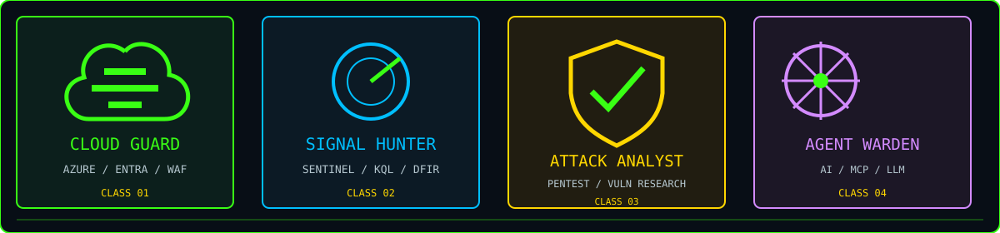

<table width="100%" cellpadding="8" cellspacing="0">
<tr>
<td width="50%" valign="top">

### <a name="cloud-class">CLOUD GUARD</a>

Azure security architecture, Azure Front Door, WAF policies, origin restrictions, Azure Policy, Key Vault, Logic Apps and infrastructure as code.

</td>
<td width="50%" valign="top">

### <a name="identity-class">IDENTITY SENTINEL</a>

Microsoft Entra ID, Conditional Access, PIM, RBAC, identity governance, cross-tenant synchronisation, SAML SSO and Zero Trust.

</td>
</tr>
<tr>
<td width="50%" valign="top">

### <a name="detection-class">SIGNAL HUNTER</a>

Microsoft Sentinel, KQL, Defender, threat hunting, incident response, malware analysis, IOC extraction, Wazuh and MISP.

</td>
<td width="50%" valign="top">

### <a name="agent-class">AGENT WARDEN</a>

AI agent and MCP server security, prompt-injection assessment, API security and the OWASP Top 10 for LLM Applications.

</td>
</tr>
</table>

## 

Pick a mission. Every card uses artwork of the same dimensions and an equal two-column layout.

<table width="100%" cellpadding="8" cellspacing="0">
<tr>
<td width="50%" valign="top">

<a href="https://github.com/GarethMSheldon/IoT-Security-Audit-Tool">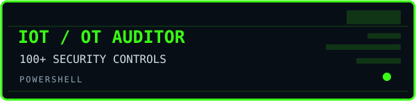</a>

**[IoT & OT Security Auditor Suite](https://github.com/GarethMSheldon/IoT-Security-Audit-Tool)**

A modular PowerShell framework for auditing IoT and OT assets. The assessment engine evaluates 100+ controls and produces quantitative risk scores with Low-to-Critical classifications. Version 2.0 also covers IT asset management and hygiene, aligned with COBIT and NIST.

`POWERSHELL` `IOT / OT` `COBIT` `NIST`

</td>
<td width="50%" valign="top">

<a href="https://github.com/GarethMSheldon/TheMSPToolkit">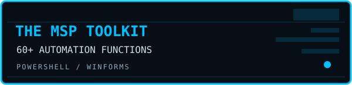</a>

**[The MSP Toolkit](https://github.com/GarethMSheldon/TheMSPToolkit)**

A GUI-based PowerShell application using WinForms/WPF, consolidating 60+ automated functions for common enterprise support tickets. Includes one-click repairs for Teams, Outlook and OneDrive, network monitoring and network stack resets.

`POWERSHELL` `WINFORMS` `WPF` `M365`

</td>
</tr>
<tr>
<td width="50%" valign="top">

**[CVE Detection Engineering](https://github.com/GarethMSheldon/React2Shell-CVE-2025-55182-Detector)**

Detection logic and vulnerability research using KQL, YARA and MITRE ATT&CK mapping. Public detector work includes React2Shell CVE-2025-55182.

`KQL` `YARA` `MITRE ATT&CK`

</td>
<td width="50%" valign="top">

<a href="https://github.com/GarethMSheldon/mcp-firewall">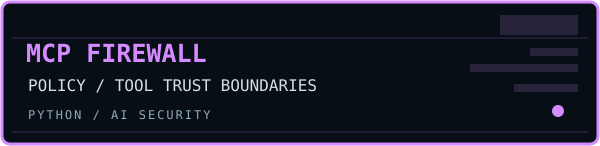</a>

**[MCP Firewall](https://github.com/GarethMSheldon/mcp-firewall)**

A Python-led security project exploring policy enforcement and trust boundaries around Model Context Protocol tool interactions. It sits alongside my wider work assessing AI agents and MCP servers.

`PYTHON` `MCP` `AI SECURITY`

</td>
</tr>
<tr>
<td width="50%" valign="top">

<a href="https://github.com/GarethMSheldon/Network-IDS-Python">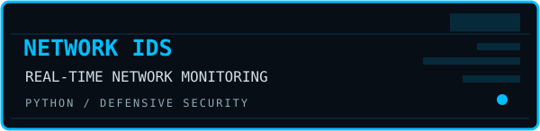</a>

**[Network IDS - Python](https://github.com/GarethMSheldon/Network-IDS-Python)**

A lightweight real-time network intrusion detection project with a Python GUI for monitoring connections and identifying suspicious activity.

`PYTHON` `NETWORK IDS` `DEFENSIVE SECURITY`

</td>
<td width="50%" valign="top">

<a href="https://github.com/GarethMSheldon/Fortinet-FortiWeb-Fabric-Connector-CVE-2025-25257-Detection">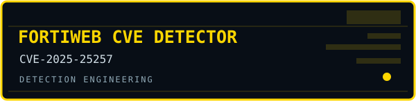</a>

**[FortiWeb CVE-2025-25257 Detection](https://github.com/GarethMSheldon/Fortinet-FortiWeb-Fabric-Connector-CVE-2025-25257-Detection)**

Detection-focused vulnerability research for Fortinet FortiWeb and its Fabric Connector.

`FORTINET` `CVE RESEARCH` `DETECTION`

</td>
</tr>
<tr>
<td width="50%" valign="top">

<a href="https://github.com/GarethMSheldon/cve-2026-22557-unifi-detection">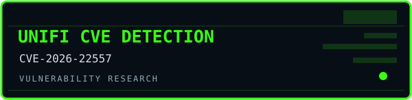</a>

**[UniFi CVE-2026-22557 Detection](https://github.com/GarethMSheldon/cve-2026-22557-unifi-detection)**

A detection project focused on research and defensive identification of CVE-2026-22557.

`UNIFI` `CVE RESEARCH` `DETECTION`

</td>
<td width="50%" valign="top">

<a href="https://github.com/GarethMSheldon/Digital-Portfolio">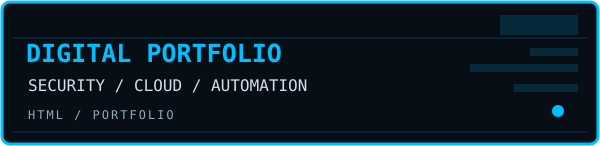</a>

**[Digital Portfolio](https://github.com/GarethMSheldon/Digital-Portfolio)**

A separate portfolio project presenting security engineering, cloud architecture, automation and infrastructure work.

`HTML` `PORTFOLIO` `SECURITY ENGINEERING`

</td>
</tr>
</table>

## 

Some more builds are in the vault. Open the inventory to see additional labs and engineering work.

<a name="inventory">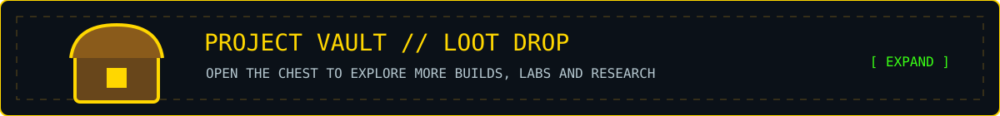</a>

 
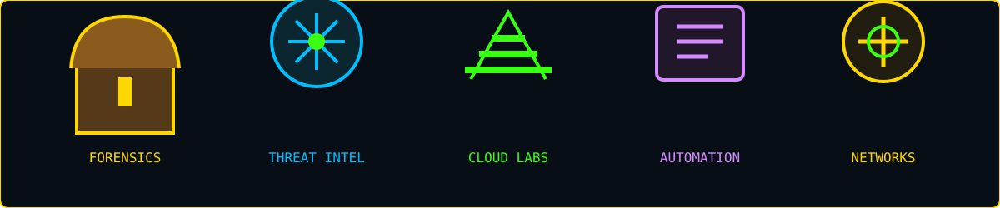

- **[MikroTik Port Scanner Protection](https://github.com/GarethMSheldon/mikrotik-port-scanner-protection):** network-focused defensive tooling.
- **[MikLink PortToPython](https://github.com/GarethMSheldon/MikLink-PortToPython):** MikroTik and Python integration project.
- **[Neural BCI Firewall Concept](https://github.com/GarethMSheldon/neural-bci-firewall-conceptual):** conceptual security research for brain-computer interface systems.

### Additional engineering and lab work

- **Threat Intelligence Nexus:** a honeypot, MISP and Microsoft Sentinel integration. Python and Azure Function Apps ingest attack patterns and indicators of compromise into Sentinel for monitoring and KQL-based detection.
- **Unified Watchtower Vision:** a Grafana dashboard combining SentinelOne, Sophos Firewall and Datto RMM telemetry, using Loki and Promtail to correlate endpoint threats, network anomalies and system health.
- **Enterprise Azure Monitor:** Log Analytics, Azure Monitor Agent, Data Collection Rules, Application Insights and Network Watcher for diagnostics and controlled telemetry collection.
- **Cilium Platform Engineer Discovery Lab:** Kubernetes networking and observability using Cilium, Hubble, Gateway API, Layer 7 traffic management and TLS termination.
- **Tirreno Internal Security Analytics:** a self-hosted application analytics deployment using PHP and PostgreSQL for audit trails and detection of account takeover and insider-threat indicators.
- **AWS IAM and Data Services Labs:** S3, DynamoDB, IAM policies, role design and least-privilege access validation.
- **Digital Forensics Lab:** deleted-file recovery, data carving and timeline analysis using Autopsy.

## 

The boss is never one thing. It is the path between exposed services, excessive privilege, weak telemetry and controls that have not been tested.

<a name="bossfight">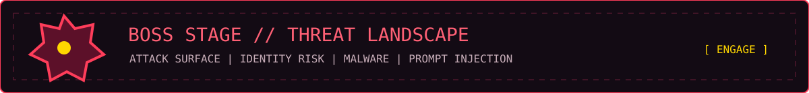</a>

 
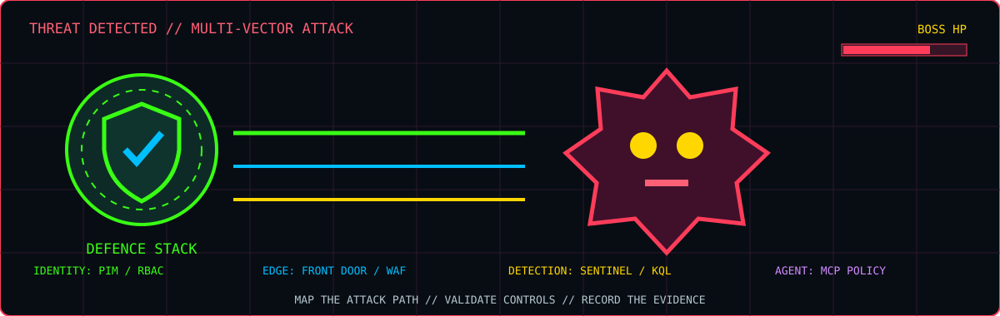

**Threats I work to understand and reduce:**

- **Cloud exposure:** public application origins, ingress paths, WAF bypass opportunities, exposed services and insecure configuration.
- **Identity compromise:** excessive privileges, risky sign-ins, legacy authentication, weak Conditional Access and lateral movement.
- **Endpoint and malware activity:** suspicious behaviour, malware execution, data exfiltration and gaps in endpoint telemetry.
- **Application and API risks:** authentication, authorisation, exposed endpoints, secrets, service principals and data access.
- **AI and MCP risks:** prompt injection, unsafe tool permissions, untrusted tool output and agent trust boundaries.

## 

### Information Security Engineer | 5CA
**July 2026 - Present**

- Secure an internal Microsoft Entra ID tenant with approximately 6,000 managed devices, 131 Conditional Access policies and 300+ enterprise applications.
- Work across 20+ Azure subscriptions and 100+ resource groups, including an Azure Virtual Desktop estate with approximately 1,400 combined users, session hosts, virtual desktops and supporting resources.
- Design and improve Azure security architecture, including Azure Front Door, WAF policies, origin restrictions, managed rules, custom rules, rate limiting and bot protection.
- Govern privileged access through Entra PIM, Azure RBAC, Conditional Access and Azure Policy.
- Review application security, API access, managed identities, service principals, secrets and production readiness.
- Build security automation using PowerShell, Azure CLI, Key Vault, Logic Apps, Bicep and Terraform.
- Develop KQL detections, investigate Sentinel and Defender alerts, support incident response and validate security controls.
- Assess AI agents and MCP servers for prompt injection and LLM application risks.

### Lead Technical Engineer & Senior Service Desk Engineer | Advania UK
**July 2025 - July 2026**

- Configured cross-tenant synchronisation and identity governance across 5+ Microsoft tenants.
- Secured Entra ID, hybrid identity and Intune environments using Conditional Access, Zero Trust and SAML SSO.
- Integrated Microsoft Defender for Cloud Apps to improve cloud activity monitoring and governance.
- Engineered Cisco routing and switching, active-passive firewalls and VPN connectivity across hybrid environments.
- Optimised Microsoft Sentinel for alert correlation, threat detection and incident investigation.
- Built Power Automate and Microsoft Graph API workflows, including integrations with Jira, Salesforce and Confluence.
- Supported GDPR, PCI DSS, ISO 27001 and Cyber Essentials compliance.

### Senior Technical & Cybersecurity Engineer | Gavotech IT Solutions
**May 2024 - June 2025**

- Configured Sophos XG and FortiGate firewalls, VPNs and secure network protocols.
- Conducted vulnerability scanning and penetration testing using Nmap, Nikto, Nessus, Qualys and Greenbone.
- Performed digital forensic investigations using Autopsy, FTK, SANS SIFT and The Sleuth Kit.
- Led incident investigation and response across cloud and on-premises environments.
- Implemented threat intelligence feeds and monitoring to identify anomalous behaviour.

### Technical Engineer | Gavotech IT Solutions
**May 2022 - May 2024**

- Managed more than 500 Windows, macOS and Linux devices and supported Windows Server and Linux server environments.
- Administered Active Directory, Group Policy, DNS, DHCP, firewalls, NAT and VPN connectivity.
- Deployed Trend Micro endpoint protection and used SentinelOne analytics to improve incident response.
- Improved system efficiency and network performance through endpoint, server and infrastructure management.

### IT Technician / Data Capturer | Pragmatic Accounting Services
**February 2021 - March 2022**

- Managed bookkeeping and data workflows for a portfolio of 15+ clients.
- Produced financial reports using Sage Pastel 50C and Microsoft Excel.
- Improved data retrieval workflows and supported client network and device management.

## 

<table width="100%" cellpadding="8" cellspacing="0">
<tr>
<td width="50%" valign="top">

### CLOUD & IDENTITY

Azure, Microsoft Entra ID, Conditional Access, PIM, RBAC, Azure Policy, Front Door, WAF, Key Vault, Intune, Microsoft 365, AWS IAM, S3 and DynamoDB.

</td>
<td width="50%" valign="top">

### SECURITY OPERATIONS

Microsoft Sentinel, KQL, Microsoft Defender, Defender for Cloud Apps, Wazuh, MISP, TheHive, Shuffle, MITRE ATT&CK, YARA and SentinelOne.

</td>
</tr>
<tr>
<td width="50%" valign="top">

### OFFENSIVE & VULNERABILITY

Kali Linux, Burp Suite, Nmap, Nikto, Tenable Nessus, Qualys, Greenbone/OpenVAS, CVSS, web application testing and vulnerability assessment.

</td>
<td width="50%" valign="top">

### FORENSICS & MALWARE

Autopsy, FTK, SANS SIFT, The Sleuth Kit, REMnux, disk imaging, data carving, timeline analysis, malware analysis and IOC extraction.

</td>
</tr>
<tr>
<td width="50%" valign="top">

### NETWORK & INFRASTRUCTURE

Sophos XG, FortiGate, Cisco, IPsec VPN, Wireshark, TCP/IP, DNS, DHCP, Windows Server, Active Directory, Linux and Docker.

</td>
<td width="50%" valign="top">

### AUTOMATION & CLOUD NATIVE

PowerShell, Python, Azure CLI, Bicep, Terraform, Power Automate, Logic Apps, Graph API, Kubernetes, Cilium, Hubble, Grafana and Loki.

</td>
</tr>
</table>

## 

<table width="100%" cellpadding="8" cellspacing="0">
<tr>
<td width="50%" valign="top">

### GOVERNANCE, RISK & COMPLIANCE

- ISO/IEC 27001:2022 Lead Auditor - Mastermind Assurance
- ISO/IEC 27001 Information Security Associate - SkillFront
- Project Management Essentials Certified - Management & Strategy Institute

### DEFENSIVE SECURITY & INCIDENT RESPONSE

- Blue Team Junior Analyst (BTJA) - Security Blue Team
- DFIR Foundations and Techniques - Blue Cape Security
- Cyber Forensics Professional - Great Learning
- Tenable Vulnerability Management Specialist
- Foundations of Operationalising MITRE ATT&CK v13
- Kaseya Certified Technician in BullPhish ID

</td>
<td width="50%" valign="top">

### CLOUD, INFRASTRUCTURE & NETWORK SECURITY

- Microsoft Applied Skills: Deploy and Configure Azure Monitor
- Microsoft Applied Skills: Administer Active Directory Domain Services
- AWS Cloud Technology Consultant Specialisation
- AWS Cloud Technical Essentials
- Certified Calico Operator: Level 1
- API Security Fundamentals
- Sophos Firewall Certified Engineer and Sophos MSP01
- Fortinet FortiGate 7.6 Operator and FCA Cybersecurity
- HPE Aruba Networking Product Specialist - SSE
- OPSWAT ICIP
- Kaseya Certified Administrator in Datto RMM

### TECHNICAL FOUNDATIONS

- Google IT Support Professional Certificate
- Scientific Computing with Python
- HackerRank Python (Basic)
- IBM Cybersecurity Fundamentals
- Foundations of Cybersecurity - Coursera
- Databricks Fundamentals

</td>
</tr>
</table>

## 

## 

<b>What areas do I work across?</b>

Cloud security architecture, identity governance, security operations, detection engineering, incident response, vulnerability assessment, digital forensics, automation and AI/MCP security.

<b>What am I currently focused on?</b>

Azure security architecture, application protection, identity attack paths, detection engineering and secure boundaries for AI agents and MCP servers.

<b>Where can you find my work?</b>

Browse the public repositories in Mission Select, visit my portfolio, or review my professional credentials and Hack The Box profile using the links below.

## 

