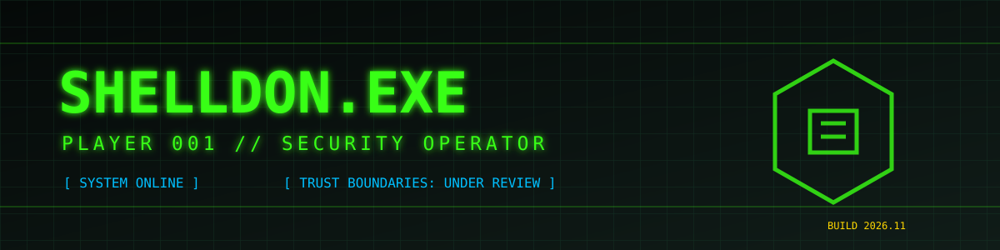
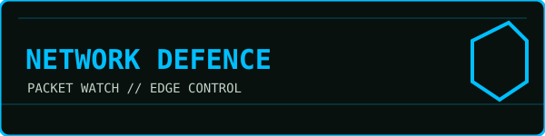
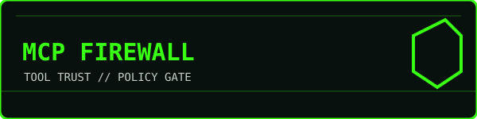

# `SHELLDON.EXE`
### GARETH SHELDON // INFORMATION SECURITY ENGINEER

**TURNING FRAGMENTED THREAT DATA INTO RESILIENT, AUDITABLE SECURITY SYSTEMS.**

`[ SYSTEM ONLINE ]` ` [ OPERATOR ACCESS ]` ` [ BUILD 2026.11 ]`

---

## `01 // PLAYER PROFILE`

I work across information security, cloud security and technical operations, with a practical focus on turning fragmented telemetry and threat data into security controls that can be tested, audited and improved.

My work spans detection engineering, cloud and identity security, vulnerability research, automation, and security tooling. I enjoy working close to the evidence: understanding how an environment behaves, finding where trust breaks down, and building repeatable ways to detect and reduce risk.

### CURRENT CAMPAIGN

- **Role:** Lead Technical Engineer & Senior Service Desk Engineer
- **Organisation:** Advania UK (Mirus IT Solutions)
- **Location:** Cape Town
- **Period:** July 2025 - Present
- **Focus:** FinTech security incidents, EDR telemetry, KQL detection, Zero Trust, automation and compliance

 

## `02 // PLAYER STATS`

<table>
<tr>
<td align="center" width="25%"><h2>5 yrs</h2>EXPERIENCE</td>
<td align="center" width="25%"><h2>30%</h2>BREACH RISK REDUCTION</td>
<td align="center" width="25%"><h2>35%</h2>MALWARE INCIDENT REDUCTION</td>
<td align="center" width="25%"><h2>4.85%</h2>HTB GLOBAL TOP</td>
</tr>
</table>

### GITHUB STATUS

`15` PUBLIC REPOSITORIES &nbsp; / &nbsp; `8` STARS &nbsp; / &nbsp; `172` CONTRIBUTIONS IN THE LAST YEAR

## `03 // HIGH SCORE TABLE`

### HACK THE BOX

**SCRIPT KIDDIE**

`RANK #1 / 6 IN SOUTH AFRICA` &nbsp; `TOP 4.85% GLOBALLY` &nbsp; `13 SOLVES`

[OPEN PLAYER PROFILE](https://app.hackthebox.com/users/1246812)

| Challenge | Type | Result | Date |
|---|---|---|---|
| Conversor | Machine | User + Root | Nov 2025 |
| RomCom | Sherlock | Full | Nov 2025 |
| Expressway | Machine | User + Root | Nov 2025 |
| Brutus | Sherlock | Full | Dec 2024 |
| UnderPass / Cap | Machines | User + Root | Dec 2024 |
| 8x Challenges | Flags | Captured | Nov 2025 |

HTB statistics and challenge records are the profile figures supplied for this README and may change over time.

## `04 // MISSION SELECT`

Selected builds, security tooling and research projects. Open each repository for source code, implementation details and current project status.

<table>
<tr>
<td width="50%" valign="top">

### [IoT & OT Security Auditor Suite](https://github.com/GarethMSheldon/IoT-Security-Audit-Tool)

PowerShell toolkit for IoT/OT security audits, with 100+ controls, a 0-100 risk score and multi-framework compliance mapping.

`POWERSHELL` `ISO 27001` `IEC 62443` `PCI-DSS` `HIPAA` `GDPR` `MDE`

</td>
<td width="50%" valign="top">

### [The MSP Toolkit](https://github.com/GarethMSheldon/TheMSPToolkit)

GUI PowerShell suite for MSP technicians, with 60+ one-click diagnostic and repair functions and real-time colour-coded logging.

`POWERSHELL` `WINDOWS FORMS` `ACTIVE DIRECTORY` `M365`

</td>
</tr>
<tr>
<td width="50%" valign="top">

### [CVE Detection Engineering Initiative](https://github.com/GarethMSheldon/React2Shell-CVE-2025-55182-Detector)

KQL queries, YARA rules and CVE-to-MITRE ATT&CK mapping for emerging vulnerabilities. Published detector projects include CVE-2025-55182 and CVE-2025-60787.

`KQL` `YARA` `SENTINEL` `MITRE ATT&CK`

</td>
<td width="50%" valign="top">

### SOC Threat Intelligence Pipeline

Honeypot, MISP and Microsoft Sentinel pipeline concept using a Python Azure Function App to ingest STIX/TAXII feeds into Log Analytics for IOC correlation.

`PYTHON` `KQL` `MISP` `STIX/TAXII` `AZURE FUNCTIONS`

</td>
</tr>
<tr>
<td width="50%" valign="top">

### Security Observability Dashboard

Grafana platform integrating SentinelOne EDR, Sophos Firewall and Datto RMM through Python for unified endpoint and network visibility.

`GRAFANA` `LOKI` `PROMQL` `PYTHON` `SENTINELONE` `SOPHOS`

</td>
<td width="50%" valign="top">

### Enterprise Azure Monitor

Azure observability design covering Log Analytics, AMA, DCRs, Application Insights, Network Watcher, NSG diagnostics and automated Action Groups.

`AZURE MONITOR` `AMA` `DCR` `KQL` `APP INSIGHTS`

</td>
</tr>
<tr>
<td width="50%" valign="top">

### [MCP Firewall](https://github.com/GarethMSheldon/mcp-firewall)

Python-led security project exploring policy enforcement and trust boundaries around Model Context Protocol tool interactions.

`PYTHON` `POWERSHELL` `MCP` `AI SECURITY`

</td>
<td width="50%" valign="top">

### [Network IDS - Python](https://github.com/GarethMSheldon/Network-IDS-Python)

Lightweight real-time network intrusion detection system with a Python GUI for monitoring connections and identifying suspicious activity.

`PYTHON` `NETWORK IDS` `WINDOWS` `LINUX`

</td>
</tr>
</table>

### MORE MISSIONS

- [MikroTik Port Scanner Protection](https://github.com/GarethMSheldon/mikrotik-port-scanner-protection)
- [MikLink PortToPython](https://github.com/GarethMSheldon/MikLink-PortToPython)
- [UniFi CVE-2026-22557 Detection](https://github.com/GarethMSheldon/cve-2026-22557-unifi-detection)
- [Fortinet FortiWeb CVE-2025-25257 Detection](https://github.com/GarethMSheldon/Fortinet-FortiWeb-Fabric-Connector-CVE-2025-25257-Detection)
- [Digital Portfolio](https://github.com/GarethMSheldon/Digital-Portfolio)
- [Neural BCI Firewall - Conceptual](https://github.com/GarethMSheldon/neural-bci-firewall-conceptual)

## `05 // ACTIVE CAMPAIGN`

### Lead Technical Engineer & Senior Service Desk Engineer
**Advania UK (Mirus IT Solutions) | Cape Town | July 2025 - Present**

- Act as an escalation point for complex FinTech security incidents, working with EDR telemetry, log analysis and root cause analysis.
- Engineer KQL detection rules and conduct threat hunts across hybrid environments, including Defender for Cloud Apps.
- Implement Zero Trust controls using Conditional Access and SAML SSO to reduce lateral movement opportunities.
- Automate SOC workflows using Power Automate and Microsoft Graph API, integrating Sentinel, Jira and Salesforce.
- Support ISO 27001 and Cyber Essentials compliance, with a reported 99.999% SLA adherence.

## `06 // PLAYER LOADOUT`

| DOMAIN | TOOLS & TECHNOLOGIES |
|---|---|
| Penetration Testing | Nmap, Burp Suite, OWASP ZAP, Nikto, SQLmap, Metasploit, Hydra, ffuf |
| SIEM & SOC | Microsoft Sentinel, Wazuh, KQL, MISP, STIX/TAXII, TheHive, Shuffle |
| Cloud Security | Azure Monitor, Log Analytics, Entra ID, Conditional Access, AWS IAM, EC2 |
| Scripting & Automation | PowerShell, Python, Bash, Power Automate, Graph API |
| Vulnerability Management | Nessus, Qualys, Greenbone GVM, Tenable, YARA, CVE triage |
| Digital Forensics | Autopsy, FTK, SANS SIFT, disk imaging, IOC extraction |
| Network Security | Sophos XG, FortiGate, Cisco, Wireshark, tcpdump, SD-WAN, IPsec |
| GRC & Compliance | ISO 27001, Cyber Essentials, PCI-DSS, GDPR, NIST CSF |
| Containers & Infrastructure | Docker, Kubernetes, Cilium, Terraform, Ansible, CI/CD |

## `07 // ACHIEVEMENTS UNLOCKED`

Selected certifications and technical credentials:

- ISO/IEC 27001:2022 Lead Auditor
- Fortinet Certified Associate Cybersecurity
- Microsoft Applied Skills: Administer Active Directory Domain Services
- Microsoft Applied Skills: Deploy and Configure Azure Monitor
- Tenable Vulnerability Management Specialist
- Sophos MSP01
- OPSWAT ICIP
- DFIR Foundations
- Additional Microsoft, AWS, Python and security training

## `08 // SYSTEM DIAGNOSTICS`

<b>What is your security philosophy?</b>

Security is an engineering discipline. I focus on understanding the environment, validating assumptions, measuring whether controls work and making the result auditable.

<b>What are you exploring?</b>

Cloud identity attack paths, threat intelligence pipelines, detection engineering, vulnerability research and security boundaries for AI agents and MCP tools.

<b>Where can I find your work?</b>

Start with the Mission Select repositories, then visit the portfolio and Credly links above.

## `09 // ESTABLISH CONNECTION`

`END OF TRANSMISSION // SHELLDON.EXE`

