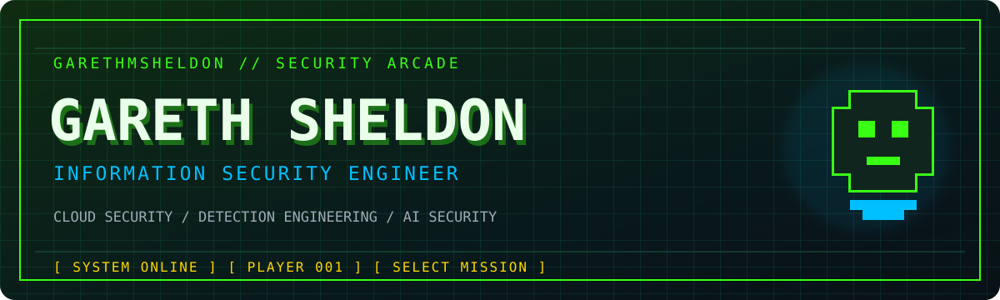
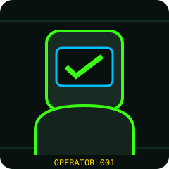

# Gareth Sheldon

### INFORMATION SECURITY ENGINEER | CLOUD SECURITY | DETECTION ENGINEERING

**Turning fragmented threat data into resilient, auditable security systems.**

\`[ SYSTEM ONLINE ]\` \`[ CYBER ARCADE ]\` \`[ PLAYER 001 ]\`

---

## \`01 // PLAYER PROFILE\`

I have more than five years of experience across IT operations, infrastructure and security, with the last two and a half years focused on information security and security engineering.

In my current role at **5CA**, I work across Azure, Microsoft Entra ID and Microsoft 365, designing, testing and implementing security controls for cloud infrastructure and applications. My work includes cloud security architecture, Azure Front Door and Web Application Firewall policies, identity governance, Conditional Access, privileged access, application security and security automation.

I also work with Microsoft Sentinel, KQL and Defender to investigate alerts, improve detection and support incident response. My security engineering work includes vulnerability assessment, penetration testing, digital forensics, malware analysis and security assessments of AI agents and Model Context Protocol (MCP) servers.

### CURRENT ROLE

**Information Security Engineer**  
5CA | July 2026 - Present

- Azure security architecture and governance
- Microsoft Entra ID and identity security
- Azure Front Door, WAF and application protection
- Microsoft Sentinel, KQL and incident response
- AI agent and MCP security assessments
- Security automation and infrastructure as code

 

## \`02 // PLAYER STATS\`

<table>
<tr>
<td align="center" width="25%"><h2>5+</h2>YEARS EXPERIENCE</td>
<td align="center" width="25%"><h2>6,000</h2>MANAGED DEVICES IN ENTRA TENANT</td>
<td align="center" width="25%"><h2>20+</h2>AZURE SUBSCRIPTIONS</td>
<td align="center" width="25%"><h2>131</h2>CONDITIONAL ACCESS POLICIES</td>
</tr>
</table>

Additional scope: 300+ enterprise applications, 100+ Azure resource groups and an Azure Virtual Desktop estate with approximately 1,400 combined users, session hosts, virtual desktops and supporting resources.

### ENGINEERING IMPACT

| AREA | REPORTED OUTCOME |
|---|---:|
| Network security at Gavotech | 30% reduction in network breaches |
| Endpoint protection at Gavotech | 35% reduction in malware incidents |
| SentinelOne operations | 30% reduction in incident response time |
| Endpoint and systems operations | 500+ managed devices |
| Systems efficiency | 20% improvement |

### GITHUB STATUS

GitHub counts are the profile figures supplied for this update and may change.

## \`03 // HIGH SCORE TABLE\`

### HACK THE BOX

**SCRIPT KIDDIE**

\`RANK #1 / 6 IN SOUTH AFRICA\` &nbsp; \`TOP 4.85% GLOBALLY\` &nbsp; \`13 SOLVES\`

| Challenge | Type | Result | Date |
|---|---|---|---|
| Conversor | Machine | User + Root | Nov 2025 |
| RomCom | Sherlock | Full | Nov 2025 |
| Expressway | Machine | User + Root | Nov 2025 |
| Brutus | Sherlock | Full | Dec 2024 |
| UnderPass / Cap | Machines | User + Root | Dec 2024 |
| 8x Challenges | Flags | Captured | Nov 2025 |

HTB rank and solve figures are previously supplied profile statistics, not a live feed.

## \`04 // MISSION SELECT\`

Selected projects from my security engineering, automation and research work.

<table>
<tr>
<td width="50%" valign="top">

### [IoT & OT Security Auditor Suite](https://github.com/GarethMSheldon/IoT-Security-Audit-Tool)

A modular PowerShell framework for auditing IoT and OT assets. The assessment engine evaluates 100+ controls and produces quantitative risk scores with Low-to-Critical classifications. Its second version also covers IT asset management and hygiene, aligned with COBIT and NIST.

\`POWERSHELL\` \`IOT / OT\` \`COBIT\` \`NIST\`

</td>
<td width="50%" valign="top">

### [The MSP Toolkit](https://github.com/GarethMSheldon/TheMSPToolkit)

A GUI-based PowerShell application using WinForms/WPF, consolidating 60+ automated functions for common enterprise support tickets. Includes one-click repairs for Teams, Outlook and OneDrive, network monitoring and network stack resets.

\`POWERSHELL\` \`WINFORMS\` \`WPF\` \`M365\`

</td>
</tr>
<tr>
<td width="50%" valign="top">

### CVE Detection Engineering & Threat Mapping

KQL detection logic and YARA rules for emerging vulnerabilities, with exploitation behaviour mapped to MITRE ATT&CK to support threat modelling and proactive hunting.

Related public work:
- [React2Shell CVE-2025-55182 Detector](https://github.com/GarethMSheldon/React2Shell-CVE-2025-55182-Detector)
- [FortiWeb CVE-2025-25257 Detection](https://github.com/GarethMSheldon/Fortinet-FortiWeb-Fabric-Connector-CVE-2025-25257-Detection)
- [UniFi CVE-2026-22557 Detection](https://github.com/GarethMSheldon/cve-2026-22557-unifi-detection)

\`KQL\` \`YARA\` \`MITRE ATT&CK\`

</td>
<td width="50%" valign="top">

### [MCP Firewall](https://github.com/GarethMSheldon/mcp-firewall)

A Python-led security project exploring policy enforcement and trust boundaries around Model Context Protocol tool interactions.

My wider AI security work includes assessing MCP servers and AI agents for prompt-injection risks and other LLM application threats, informed by the OWASP Top 10 for LLM Applications.

\`PYTHON\` \`MCP\` \`AI SECURITY\`

</td>
</tr>
<tr>
<td width="50%" valign="top">

### Threat Intelligence Nexus

A honeypot, MISP and Microsoft Sentinel integration. Python and Azure Function Apps ingest attack patterns and indicators of compromise into Sentinel for monitoring and KQL-based detection.

\`PYTHON\` \`MISP\` \`AZURE FUNCTIONS\` \`SENTINEL\`

</td>
<td width="50%" valign="top">

### Unified Watchtower Vision

A centralised Grafana dashboard combining SentinelOne, Sophos Firewall and Datto RMM telemetry. Uses Loki and Promtail to correlate endpoint threats, network anomalies and system health.

\`GRAFANA\` \`LOKI\` \`PROMTAIL\` \`SENTINELONE\`

</td>
</tr>
<tr>
<td width="50%" valign="top">

### Enterprise Azure Monitor

An Azure monitoring implementation using Log Analytics, Azure Monitor Agent, Data Collection Rules, Application Insights and Network Watcher for full-stack diagnostics and controlled telemetry collection.

\`AZURE MONITOR\` \`AMA\` \`DCR\` \`KQL\`

</td>
<td width="50%" valign="top">

### Cilium Platform Engineer Discovery Lab

A cloud-native networking lab exploring Kubernetes observability and traffic management with Cilium and Hubble, including Gateway API, Layer 7 traffic management and TLS termination.

\`KUBERNETES\` \`CILIUM\` \`HUBBLE\` \`GRAFANA\`

</td>
</tr>
</table>

### MORE BUILDS

- [Network IDS - Python](https://github.com/GarethMSheldon/Network-IDS-Python)
- [MikroTik Port Scanner Protection](https://github.com/GarethMSheldon/mikrotik-port-scanner-protection)
- [MikLink PortToPython](https://github.com/GarethMSheldon/MikLink-PortToPython)
- [Digital Portfolio](https://github.com/GarethMSheldon/Digital-Portfolio)
- [Neural BCI Firewall - Conceptual](https://github.com/GarethMSheldon/neural-bci-firewall-conceptual)

## \`05 // CAREER CAMPAIGN\`

### Information Security Engineer | 5CA
**July 2026 - Present**

- Secure an internal Microsoft Entra ID tenant with approximately 6,000 managed devices, 131 Conditional Access policies and 300+ enterprise applications.
- Work across 20+ Azure subscriptions and 100+ resource groups, including an Azure Virtual Desktop estate with approximately 1,400 combined users, hosts, desktops and supporting resources.
- Design and improve Azure security architecture, including Azure Front Door, WAF policies, origin restrictions, managed rules, custom rules, rate limiting and bot protection.
- Govern privileged access through Entra PIM, Azure RBAC, Conditional Access and Azure Policy.
- Review application security, API access, managed identities, service principals, secrets and production readiness.
- Build security automation using PowerShell, Azure CLI, Key Vault, Logic Apps, Bicep and Terraform.
- Develop KQL detections, investigate Sentinel and Defender alerts, support incident response and validate security controls.
- Assess AI agents and MCP servers for prompt injection and LLM application risks.

### Lead Technical Engineer & Senior Service Desk Engineer | Advania UK
**July 2025 - July 2026**

- Configured cross-tenant synchronisation and identity governance across 5+ Microsoft tenants.
- Secured Entra ID, hybrid identity and Intune environments using Conditional Access, Zero Trust and SAML SSO.
- Integrated Microsoft Defender for Cloud Apps to improve cloud activity monitoring and governance.
- Engineered Cisco routing and switching, active-passive firewalls and VPN connectivity across hybrid environments.
- Optimised Microsoft Sentinel for alert correlation, threat detection and incident investigation.
- Built Power Automate and Microsoft Graph API workflows, including integrations with Jira, Salesforce and Confluence.
- Supported GDPR, PCI DSS, ISO 27001 and Cyber Essentials compliance.

### Senior Technical & Cybersecurity Engineer | Gavotech IT Solutions
**May 2024 - June 2025**

- Configured Sophos XG and FortiGate firewalls, VPNs and secure network protocols.
- Conducted vulnerability scanning and penetration testing using Nmap, Nikto, Nessus, Qualys and Greenbone.
- Performed digital forensic investigations using Autopsy, FTK, SANS SIFT and The Sleuth Kit.
- Led incident investigation and response across cloud and on-premises environments.
- Implemented threat intelligence feeds and monitoring to identify anomalous behaviour.

### Technical Engineer | Gavotech IT Solutions
**May 2022 - May 2024**

- Managed more than 500 Windows, macOS and Linux devices and supported Windows Server and Linux server environments.
- Administered Active Directory, Group Policy, DNS, DHCP, firewalls, NAT and VPN connectivity.
- Deployed Trend Micro endpoint protection and used SentinelOne analytics to improve incident response.
- Improved system efficiency and network performance through endpoint, server and infrastructure management.

### IT Technician / Data Capturer | Pragmatic Accounting Services
**February 2021 - March 2022**

- Managed bookkeeping and data workflows for a portfolio of 15+ clients.
- Produced financial reports using Sage Pastel 50C and Microsoft Excel.
- Improved data retrieval workflows and supported client network and device management.

## \`06 // PLAYER LOADOUT\`

| SPECIALISATION | TECHNOLOGIES |
|---|---|
| Cloud & Identity Security | Azure, Microsoft Entra ID, Conditional Access, PIM, RBAC, Azure Policy, Azure Front Door, WAF, Key Vault, Intune |
| Security Operations | Microsoft Sentinel, KQL, Microsoft Defender, Defender for Cloud Apps, incident response, threat hunting |
| AI & Application Security | MCP security, AI agent security, prompt-injection assessment, API security, OWASP Top 10 for LLM Applications |
| Vulnerability & Offensive Security | Kali Linux, Burp Suite, Nmap, Nikto, Nessus, Qualys, Greenbone/OpenVAS, CVSS |
| Digital Forensics & Malware | Autopsy, FTK, SANS SIFT, The Sleuth Kit, REMnux, IOC extraction, malware analysis |
| Network & Endpoint Security | Sophos XG, FortiGate, Cisco, IPsec VPN, Wireshark, TCP/IP, DNS, DHCP, SentinelOne |
| Automation & IaC | PowerShell, Python, Azure CLI, Bicep, Terraform, Power Automate, Logic Apps, Microsoft Graph API |
| Cloud Native & Observability | Docker, Kubernetes, Cilium, Hubble, Grafana, Loki, Promtail |
| Governance & Compliance | ISO/IEC 27001:2022, CIS Benchmarks, NIST, CISA guidance, GDPR, PCI DSS, Cyber Essentials, COBIT |

## \`07 // ACHIEVEMENTS UNLOCKED\`

Selected certifications and professional training from my certification record.

**Governance, Risk & Compliance**
- ISO/IEC 27001:2022 Lead Auditor - Mastermind Assurance
- ISO/IEC 27001 Information Security Associate - SkillFront
- Project Management Essentials Certified - Management & Strategy Institute

**Defensive Security & Incident Response**
- Blue Team Junior Analyst (BTJA) - Security Blue Team
- DFIR Foundations and Techniques - Blue Cape Security
- Cyber Forensics Professional - Great Learning
- Tenable Vulnerability Management Specialist - Tenable
- Foundations of Operationalising MITRE ATT&CK v13 - AttackIQ
- Kaseya Certified Technician in BullPhish ID

**Cloud, Infrastructure & Network Security**
- Microsoft Applied Skills: Deploy and Configure Azure Monitor
- Microsoft Applied Skills: Administer Active Directory Domain Services
- AWS Cloud Technology Consultant Specialisation
- AWS Cloud Technical Essentials
- Certified Calico Operator: Level 1 - Tigera
- API Security Fundamentals - APIsec University
- Sophos Firewall Certified Engineer
- Sophos MSP01
- Fortinet FortiGate 7.6 Operator
- Fortinet Certified Associate (FCA) Cybersecurity
- HPE Aruba Networking Product Specialist - SSE
- OPSWAT Introduction to Critical Infrastructure Protection (ICIP)
- Kaseya Certified Administrator in Datto RMM

**Technical Foundations & Automation**
- Google IT Support Professional Certificate
- Scientific Computing with Python - freeCodeCamp
- HackerRank Python (Basic)
- Cybersecurity Fundamentals - IBM SkillsBuild
- Foundations of Cybersecurity - Coursera
- Databricks Fundamentals

## \`08 // EDUCATION\`

**BSc Cybersecurity**  
IU International University of Applied Sciences | January 2025 - December 2029

Relevant study areas include cybersecurity, data protection, ethical hacking, digital forensics, computing, networking, operating systems and Python.

## \`09 // SYSTEM DIAGNOSTICS\`

<b>What areas do you work across?</b>

Cloud security architecture, identity governance, security operations, detection engineering, incident response, vulnerability assessment, digital forensics, automation and AI/MCP security.

<b>What are you currently exploring?</b>

Cloud security architecture, Azure application protection, identity attack paths, detection engineering, threat intelligence and secure boundaries for AI agents and MCP servers.

<b>Where can I find your work?</b>

Browse the public repositories in Mission Select, visit my portfolio, or review my professional credentials and Hack The Box profile using the links above.

## \`10 // ESTABLISH CONNECTION\`

\`END OF TRANSMISSION // GARETH SHELDON\`

